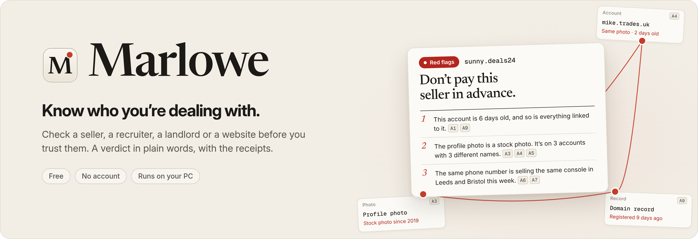
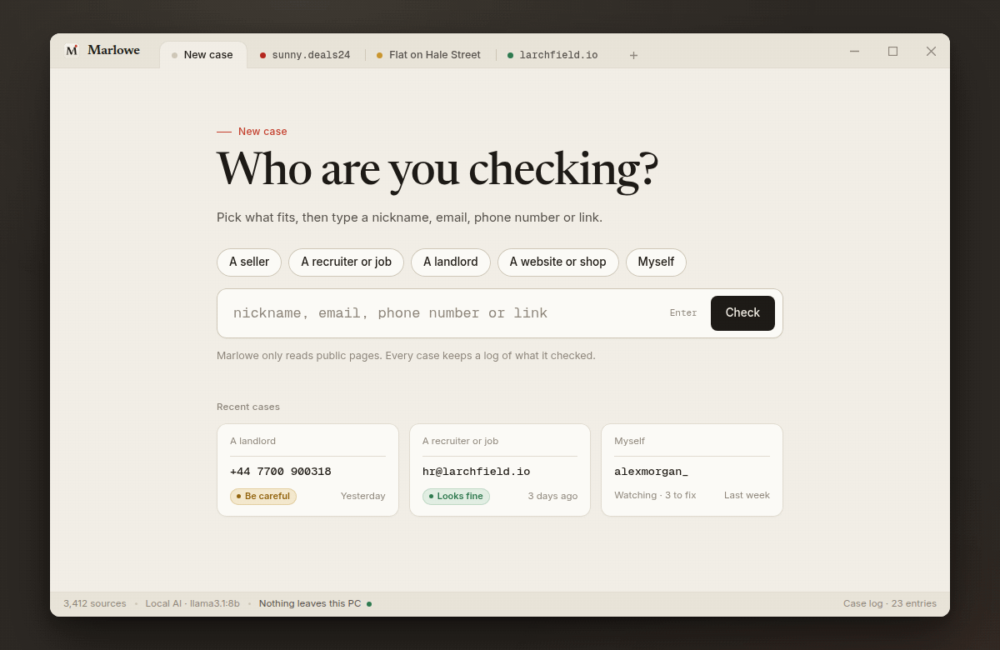
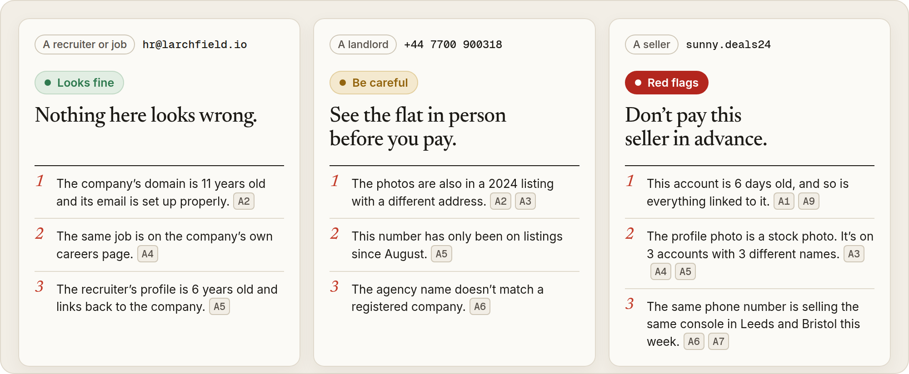
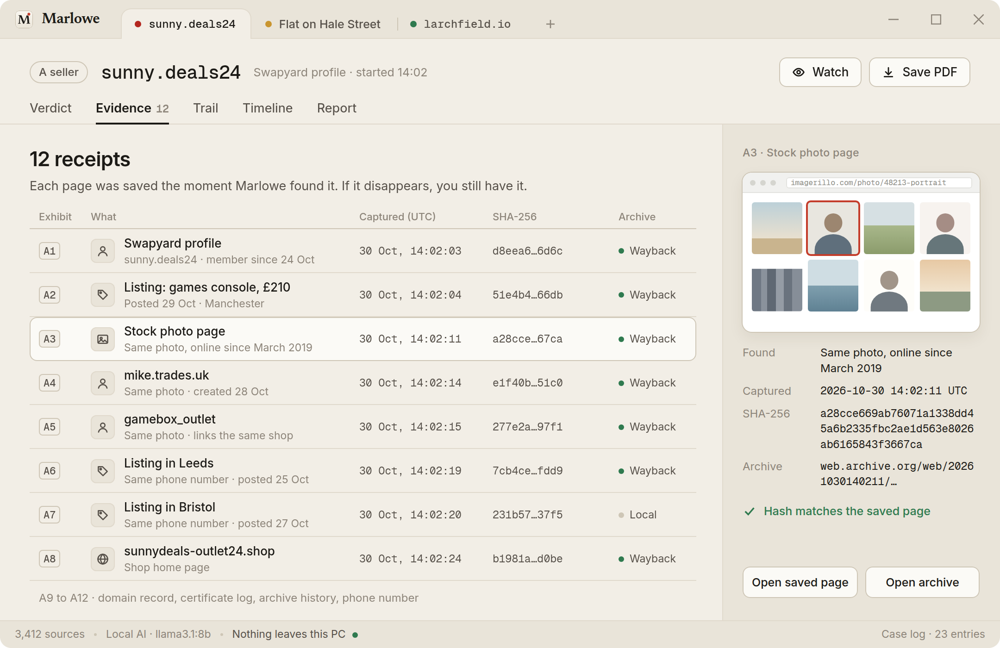
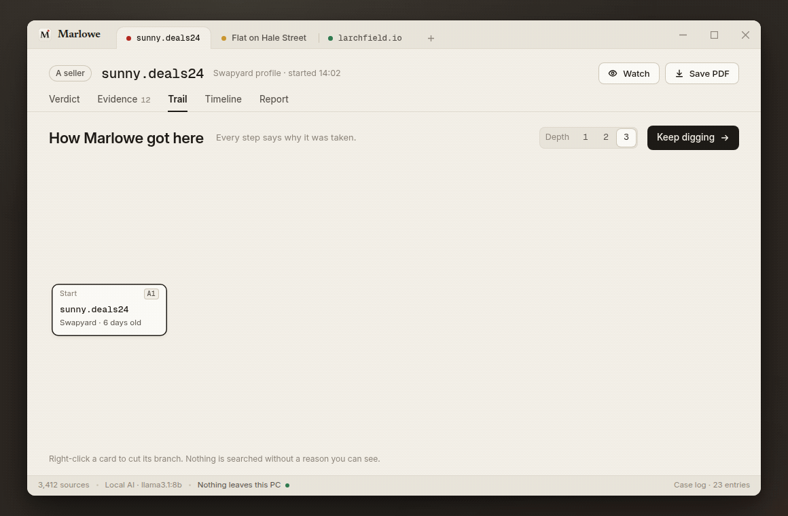
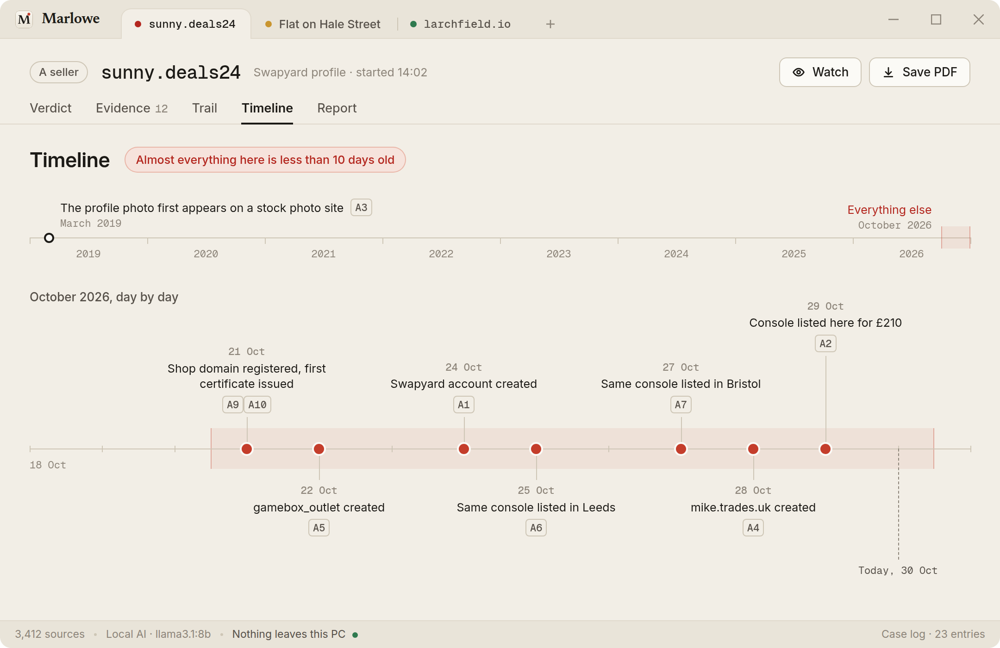
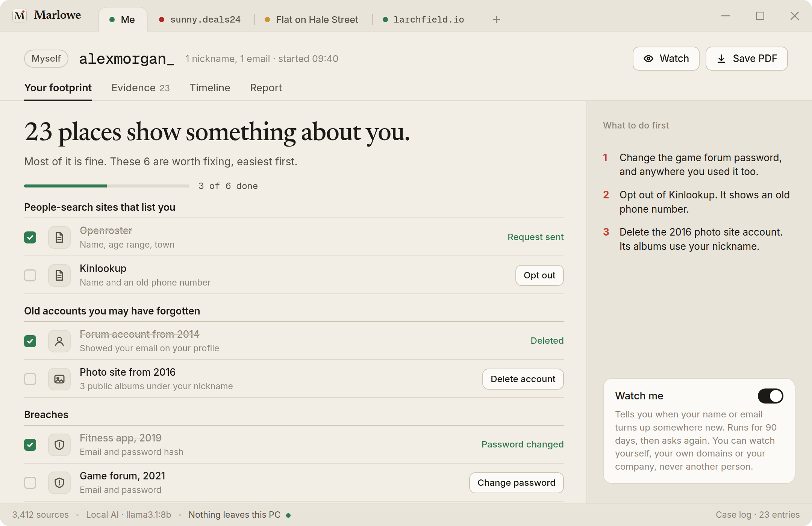
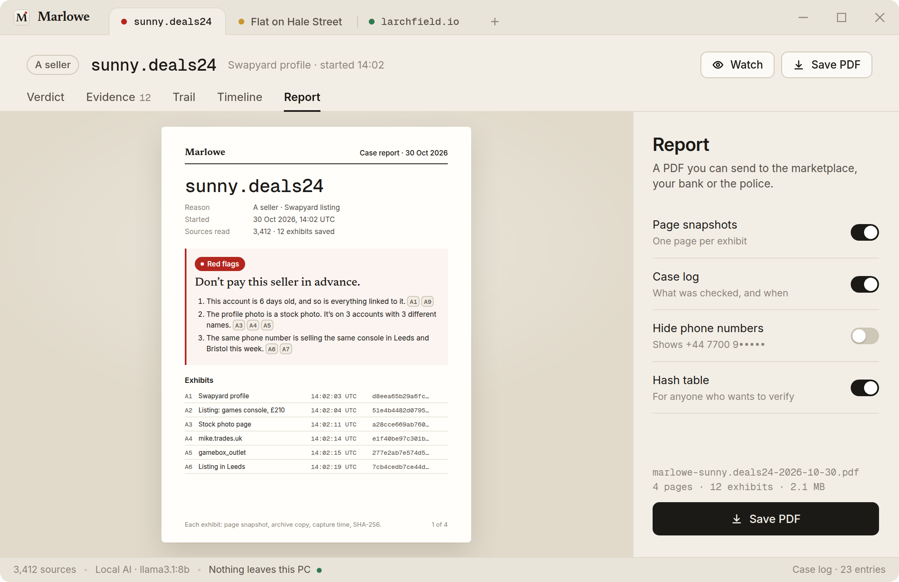

<p align="center">
  
</p>

<p align="center">
  <a href="#download"></a>
  
  <a href="LICENSE"></a>
  
  
</p>

<p align="center">
  <a href="#download">Download</a> ·
  <a href="#how-to-use">How to use</a> ·
  <a href="#what-makes-it-different">What makes it different</a> ·
  <a href="#use-it-right">Use it right</a> ·
  <a href="#faq">FAQ</a>
</p>

<p align="center">
  
</p>

<h3 align="center">Feel like Sherlock Holmes. Check anyone before you trust them.</h3>

Before you send a deposit, take the job or hand over the keys, check who's on the other end. Type a nickname, email, phone number or link. Marlowe reads 3,400+ public sources and gives you a verdict in plain words. Every claim comes with a receipt: a saved copy of the page it came from.

It's free, there's no account, and it runs on your PC.

## Download

One zip, attached to the [latest release](https://github.com/ArcSwordKiln/osint-people-checker/releases/latest). It carries `Main.exe`, its update settings and the `marlowe` runtime, so nothing else has to be installed:

| System | File |
|---|---|
| Windows 10 and 11 | [`osint-people-checker.zip`](releases/latest) |

Unpack the whole folder and start `Main.exe`. No admin rights.

> [!NOTE]
> `Main.exe` is code-signed, so Windows starts it without a warning. Keep `marlowe` next to it: they ship together.

## How to use

1. Pick what you're checking: **A seller**, **A recruiter or job**, **A landlord**, **A website or shop**, or **Myself**.
2. Type what you have: a nickname, email, phone number or link. Press **Enter**.
3. Read the verdict. Click any exhibit tag, like `A3`, to see the saved page behind it.

The first choice matters. Checking a seller looks at account age, reused photos and the same phone number on other listings. Checking a website looks at the domain, its certificates and its archive history. The verdict is worded for the situation you're in.

## What makes it different

### A verdict, not a pile of links

<p align="center">
  
</p>

Every check ends in **Looks fine**, **Be careful** or **Red flags**, with three reasons in plain words. Each reason names the exhibits behind it, so you can check the proof yourself in one click. When Marlowe isn't sure, it says so instead of guessing.

### Receipts for everything

<p align="center">
  
</p>

Each page is saved the moment it's found: a local snapshot, a copy in the Wayback Machine, the time in UTC and a SHA-256 hash. If the seller deletes the account tomorrow, you still have proof, and anyone can check that it hasn't been changed.

### Keep digging

<p align="center">
  
</p>

One clue leads to the next. The profile photo turns up on two more accounts. The phone number in the listing is selling the same console in two other cities. The shop in the bio sits on a domain registered last week. Marlowe follows each lead for you, up to three steps deep. Every string says why that step was taken, and you can cut any branch you don't want followed.

### The timeline

<p align="center">
  
</p>

Every date Marlowe finds goes on one line: when accounts were created, when the domain was registered, when listings went up and when the photo first appeared. A real person leaves a trail that goes back years. A fake one shows up as a cluster of brand-new everything.

### Also in the box

<table>
  <tr>
    <td width="50%"></td>
    <td width="50%"></td>
  </tr>
  <tr>
    <td align="center"><sub><b>Check yourself.</b> See what's out there about you, with opt-out links and a to-do list</sub></td>
    <td align="center"><sub><b>PDF report.</b> Send it to the marketplace, your bank or the police</sub></td>
  </tr>
</table>

- **Watch.** Marlowe keeps an eye on yourself, your own domains or your company, and tells you when something new appears. Every watch expires after 90 days unless you renew it.
- **Local AI.** Verdicts are written by a local model through [Ollama](https://ollama.com), or by plain rules if you'd rather not use AI at all. Nothing leaves your PC unless you choose an online model in Settings.
- **Same picture, not same face.** Photo matching compares the image itself. Marlowe never runs face recognition.

## Where the data comes from

Marlowe only uses public pages and free, keyless services. Nothing needs an account.

| Source | What it tells you |
|---|---|
| 3,400+ site checks in [`sources/`](sources) | Which sites have an account with that name, and when it was created |
| RDAP and WHOIS | When a domain was registered and who registered it, if that's public |
| Certificate logs (crt.sh, CertSpotter) | When a website first went online |
| Wayback Machine | What a page looked like before, and where your receipts are archived |
| DNS over HTTPS | Whether a company's email is set up properly |
| Gravatar, GitHub, Bluesky, Mastodon | Public profiles linked to an email or a name |
| Have I Been Pwned | Known breaches. Searching by email needs your own HIBP key, which is optional |

Site checks are plain TOML, one entry per site. A check that only finds a bot wall or a login page reports "couldn't check" rather than a hit.

## Use it right

Marlowe is for checking people and businesses **before you deal with them**: a seller, a recruiter, a landlord, a shop, or yourself.

**What Marlowe won't do:**

- Look up home addresses or anyone's live location.
- Search faces of strangers.
- Log into accounts or read anything behind a login.
- Try password reset pages to see whether an email is registered.
- Put a private person on watch.

Requests are slow and polite, and each case keeps a log of what was checked and when.

> [!WARNING]
> Marlowe isn't a consumer reporting agency. Don't use it to screen tenants or job applicants, or to make decisions about credit, insurance or employment. In the US that's covered by the FCRA. Checking a landlord or a recruiter before you deal with them is fine. Screening people who apply to you isn't.

If you investigate on someone else's behalf in the EU or UK, you're the data controller. You need a legitimate reason, and you should keep only what you need. Marlowe never collects sensitive data such as health, religion or politics.

## Build from source

You need Rust 1.85 or newer and the [Tauri prerequisites](https://v2.tauri.app/start/prerequisites/) for your system.

```bash
git clone https://github.com/ArcSwordKiln/osint-people-checker.git
cd osint-people-checker
cargo test --workspace
cargo tauri build
```

| Path | What's inside |
|---|---|
| `crates/marlowe-core` | Checks, verdicts and receipts |
| `app/` | The desktop window and its icons |
| `sources/` | Site checks, one TOML entry per site |
| `assets/` | Images for this README |

## FAQ

<details>
<summary><b>Is it really free?</b></summary>

Yes. There's no paid plan, no trial and no account, and every feature works without paying for anything. If you already have a Have I Been Pwned key, you can add it for breach checks by email.
</details>

<details>
<summary><b>Does "Red flags" mean the person is a scammer?</b></summary>

No. It means the public signals look like the ones scams usually leave, such as brand-new accounts, a reused photo and the same number in several cities. Read the reasons and open the receipts before you decide. When the signals are mixed, Marlowe says **Be careful** instead.
</details>

<details>
<summary><b>Where are my cases stored?</b></summary>

On your PC, in Marlowe's data folder. Snapshots and the case log stay local. Archive copies are made in the Wayback Machine, which is public, and you can turn that off in Settings.
</details>

<details>
<summary><b>A result is wrong. What now?</b></summary>

Right-click the finding and choose **Not this person**. It's removed from the verdict and the case log records why. If a site check is broken, open an issue with the site name and attach the case log.
</details>

<details>
<summary><b>Can I check someone just because I'm curious?</b></summary>

Please don't. Marlowe asks why you're checking before it starts, and the case log keeps that reason. See [Use it right](#use-it-right).
</details>

<details>
<summary><b>Is Marlowe a free alternative to Sherlock or Maigret?</b></summary>

It starts from the same idea, one name checked across thousands of sites, and adds what those command-line tools leave out: a window instead of a terminal, a verdict in plain words, saved proof for every finding and a trail that explains each step. They're great tools. Marlowe is for people who'd rather not open a terminal.
</details>

## License

Marlowe is [MIT](LICENSE) licensed. The UI bundles Inter, Newsreader and Geist Mono, all under the SIL Open Font License 1.1.

Marlowe isn't affiliated with any of the sites or services it checks. All product names belong to their owners.

Sherlock Holmes is mentioned as a figure of speech. Sherlock and Maigret are independent open-source projects, named for comparison only.
